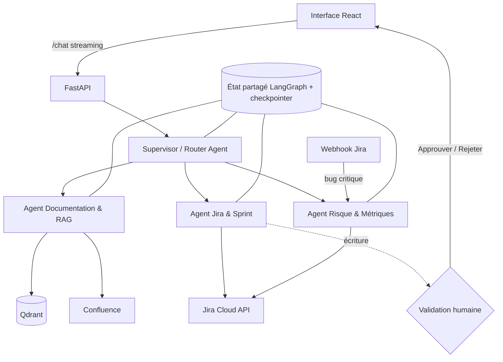

# 🤖 AgileCortex : assistant multi-agents Delivery & Support

> Un assistant conversationnel multi-agents qui connecte **Jira**, **Confluence** et des **métriques Scrum** pour automatiser la gestion de projet, répondre aux questions techniques et **prédire les retards de livraison** avant qu'ils n'arrivent.


---

## 📑 Sommaire

- [Contexte et objectifs](#-contexte-et-objectifs)
- [Architecture](#-architecture)
- [Les agents](#-les-agents)
- [Fonctionnalités avancées](#-fonctionnalités-avancées)
- [Stack technique](#-stack-technique)
- [Structure du projet](#-structure-du-projet)
- [Installation](#-installation)
- [Configuration](#-configuration)
- [Utilisation](#-utilisation)
- [Exemple de scénario](#-exemple-de-scénario)
- [Tests](#-tests)
- [Organisation de l'équipe](#-organisation-de-léquipe)
- [Feuille de route](#-feuille-de-route)
- [Contribuer](#-contribuer)
- [Licence](#-licence)

---

## 🎯 Contexte et objectifs

Les équipes de delivery jonglent entre Jira (quoi faire), Confluence (comment le faire) et des tableaux de bord statiques (ce qui s'est déjà passé). **AgileCortex** réunit ces trois mondes dans une seule interface de chat pilotée par des agents spécialisés.

**Objectifs :**

- Répondre aux questions techniques avec **sources citées** (runbooks, guides de déploiement).
- Automatiser les tâches Jira : créer des User Stories, gérer le backlog, changer les statuts, assigner les tickets.
- Passer d'un reporting **réactif** à une gestion **proactive** : score de risque de retard, détection des blockers non assignés.
- Garder l'humain aux commandes : **aucune écriture Jira sans validation** (Human-in-the-Loop).

---

## 🏗 Architecture



Les agents communiquent via un **état partagé** (`GraphState`, modèle Pydantic) géré par LangGraph. Cela permet, par exemple, à l'agent Jira de transmettre un code d'erreur trouvé dans un ticket à l'agent RAG, qui va chercher le guide de résolution correspondant.

---

## 🧠 Les agents

| Agent | Rôle | Outils |
|---|---|---|
| **Supervisor / Router** | Analyse l'intention, route vers le bon agent, synthétise la réponse finale | `route_to_specialist_agent` |
| **Documentation & RAG** | Recherche dans la documentation interne et cite ses sources | `search_confluence_docs`, `fetch_confluence_page_content` |
| **Jira & Sprint** | Exécute les actions de gestion de projet | `search_jira_issues`, `create_user_story`, `manage_backlog_item`, `update_issue_status`, `assign_ticket` |
| **Delivery Risk & Metrics** | Analyse la vélocité et prédit les retards | `calculate_sprint_velocity`, `get_cycle_time_metrics`, `check_unassigned_blockers`, `compute_delay_risk_score` |
| *(Optionnel)* **Code / Technical Review** | Analyse les stack traces et les PR, relie à l'historique Jira | à définir |

---

## ✨ Fonctionnalités avancées

- **Human-in-the-Loop (HITL)** : toute écriture Jira est mise en pause (`interrupt` / `resume` LangGraph) et présentée sous forme de carte « Approuver / Rejeter » dans l'interface.
- **État partagé (blackboard)** : les agents collaborent via un état persistant, avec checkpointer.
- **RBAC** : Développeurs, Scrum Masters et Clients voient des vues différentes, appliquées côté API (AWS Cognito / IAM).
- **Déclencheurs événementiels** : un webhook Jira active l'agent Risque à l'ouverture d'un bug critique et génère un résumé d'incident.

---

## 🧰 Stack technique

| Couche | Technologies |
|---|---|
| Orchestration | LangGraph, Pydantic |
| LLM | Ollama / vLLM (Llama 3.1, Qwen 2.5) |
| RAG | Qdrant (ou ChromaDB), embeddings HuggingFace (`nomic-embed-text`, `bge-large-en-v1.5`) |
| Intégrations | `atlassian-python-api`, Jira REST API, Confluence API (MCP optionnel) |
| Métriques | Python, NumPy |
| Backend | FastAPI (streaming SSE) |
| Frontend | React, Vite |
| Auth & événements | AWS Cognito / IAM, AWS Lambda |
| Infra locale | Docker, Docker Compose |

---

## 📁 Structure du projet

```
agilecortex/
├── backend/
│   ├── app/
│   │   ├── main.py                 # Point d'entrée FastAPI
│   │   ├── api/                    # Routes (/chat, /approvals, /webhooks)
│   │   ├── graph/
│   │   │   ├── state.py            # GraphState (Pydantic)
│   │   │   ├── supervisor.py       # Agent routeur
│   │   │   └── builder.py          # Construction du graphe LangGraph
│   │   ├── agents/
│   │   │   ├── rag_agent.py
│   │   │   ├── jira_agent.py
│   │   │   └── risk_agent.py
│   │   ├── tools/                  # Un fichier par outil
│   │   ├── integrations/           # Clients Jira / Confluence (retry, cache)
│   │   ├── auth/                   # Cognito, rôles
│   │   └── config.py
│   ├── scripts/
│   │   ├── seed_jira.py            # Peuple Jira avec des données réalistes
│   │   ├── seed_confluence.py      # Peuple Confluence (runbooks, guides)
│   │   └── ingest_confluence.py    # Ingestion vers Qdrant
│   └── tests/
├── frontend/
│   ├── src/
│   │   ├── components/             # Chat, ApprovalCard, Dashboard
│   │   ├── pages/
│   │   └── hooks/
│   └── package.json
├── docs/                           # Architecture, contrats OpenAPI, démo
├── docker-compose.yml
├── .env.example
└── README.md
```

---

## 🚀 Installation

### Prérequis

- Docker et Docker Compose
- Python 3.11+
- Node.js 20+
- Un compte **Jira Cloud** et un espace **Confluence** (plan gratuit suffisant)
- [Ollama](https://ollama.com) installé en local

### 1. Cloner le dépôt

```bash
git clone https://github.com/<votre-organisation>/agilecortex.git
cd agilecortex
```

### 2. Configurer l'environnement

```bash
cp .env.example .env
# Renseigner les variables (voir section Configuration)
```

### 3. Lancer l'infrastructure

```bash
docker compose up -d        # Qdrant + API
ollama pull llama3.1        # Modèle LLM local
```

### 4. Installer le backend

```bash
cd backend
python -m venv .venv
source .venv/bin/activate   # Windows : .venv\Scripts\activate
pip install -r requirements.txt
```

### 5. Peupler Jira et Confluence (première fois)

```bash
python scripts/seed_jira.py
python scripts/seed_confluence.py
python scripts/ingest_confluence.py
```

### 6. Lancer l'API et le frontend

```bash
uvicorn app.main:app --reload          # http://localhost:8000
cd ../frontend && npm install && npm run dev   # http://localhost:5173
```

---

## ⚙️ Configuration

Variables à définir dans `.env` :

```env
# Atlassian
ATLASSIAN_BASE_URL=https://votre-site.atlassian.net
ATLASSIAN_EMAIL=vous@exemple.com
ATLASSIAN_API_TOKEN=xxxxxxxx
JIRA_PROJECT_DEMO=DEMO
JIRA_PROJECT_SANDBOX=SBX
CONFLUENCE_SPACE_KEY=DOCS

# LLM & embeddings
OLLAMA_BASE_URL=http://localhost:11434
LLM_MODEL=llama3.1
EMBEDDING_MODEL=BAAI/bge-large-en-v1.5

# Vector store
QDRANT_URL=http://localhost:6333
QDRANT_COLLECTION=confluence_docs

# Auth (optionnel en dev)
AWS_REGION=eu-west-1
COGNITO_USER_POOL_ID=
COGNITO_CLIENT_ID=
```

> ⚠️ **Ne jamais commiter le fichier `.env`.** Il est listé dans `.gitignore`.

> 🛡️ **Règle d'or :** en développement, toutes les écritures Jira ciblent uniquement le projet **sandbox** (`JIRA_PROJECT_SANDBOX`). Le projet démo reste en lecture seule.

---

## 💬 Utilisation

Exemples de requêtes dans le chat :

| Rôle | Requête |
|---|---|
| Développeur | « Comment déployer le service de paiement en préprod ? » |
| Développeur | « Voici la stack trace, y a-t-il un ticket similaire déjà résolu ? » |
| Product Manager | « Crée une user story pour le mode sombre et mets-la dans le prochain sprint. » |
| Scrum Master | « Quel est le risque de retard du sprint en cours ? » |
| Scrum Master | « Quels blockers ne sont pas assignés ? » |

---

## 🎬 Exemple de scénario

**Demande :** « Ajoute une fonctionnalité de mode sombre dans le frontend, crée une user story et mets-la dans le prochain sprint. »

1. **Supervisor** : détecte l'intention et route vers l'agent Jira.
2. **Agent Jira** : prépare la création de la story :
   - *Titre :* `[FEAT] Dark Mode Interface`
   - *Description :* En tant qu'utilisateur de nuit, je veux un thème sombre afin de réduire la fatigue visuelle.
3. **HITL** : une carte d'aperçu s'affiche dans l'UI. Le PM clique sur **Approuver**.
4. **Agent Jira** : crée la story et l'ajoute au Sprint Backlog.
5. **Supervisor** : transmet à l'agent Risque.
6. **Agent Risque** : vérifie la surcharge du sprint par rapport à la vélocité de l'équipe et renvoie l'impact à l'UI.

---

## 🧪 Tests

```bash
cd backend
pytest tests/                 # Tests unitaires et d'intégration
pytest tests/ -m integration  # Tests contre l'instance Jira/Confluence réelle
```

Les tests d'intégration utilisent la **vraie instance** (projet sandbox). Les réponses sont enregistrées (VCR) uniquement pour la CI.

---

## 👥 Organisation de l'équipe

| Membre | Responsabilités |
|---|---|
| **Imen Miladi** | Orchestration (Supervisor, état partagé), agent Jira, HITL (backend), webhooks, authentification |
| **Wajd Harrar** | Agent RAG, agent Risque & métriques, interface React, HITL (UI), vues par rôle |

**Workflow Git :**

- Branche principale : `main` (protégée)
- Branches de travail : `feature/US-XX-description`
- Pull Request obligatoire, relue par l'autre développeur
- Commits au format [Conventional Commits](https://www.conventionalcommits.org/) (`feat:`, `fix:`, `docs:`…)

**Definition of Done :** PR relue, tests passants, aucune écriture Jira sans validation HITL, documentation à jour (README + OpenAPI).

---

## 🗺 Feuille de route

- [ ] **Sprint 0** : Fondations, accès Jira/Confluence réels, script de seed
- [ ] **Sprint 1** : Squelettes des agents (Supervisor, Jira JQL, ingestion Confluence)
- [ ] **Sprint 2** : Outils métier (User Stories, backlog, vélocité, cycle time, RAG avec sources)
- [ ] **Sprint 3** : Collaboration entre agents, HITL, score de risque, tableau de bord
- [ ] **Sprint 4** : Webhooks proactifs, RBAC, vue client, tests e2e, démo
- [ ] *(Optionnel)* Agent de revue de code

---

## 🤝 Contribuer

1. Créer une branche : `git checkout -b feature/US-XX-ma-fonctionnalite`
2. Committer : `git commit -m "feat: ajoute l'outil assign_ticket"`
3. Pousser : `git push origin feature/US-XX-ma-fonctionnalite`
4. Ouvrir une Pull Request et demander une relecture

---

## 📄 Licence

Ce projet est distribué sous licence MIT. Voir le fichier [LICENSE](LICENSE) pour plus de détails.

---

<p align="center">Fait avec ❤️ par <b>Imen Miladi</b> et <b>Wajd Harrar</b></p>
